# Hướng dẫn sử dụng OmniTest

<!-- File sinh tự động từ apps/web/src/lib/guide.json bằng infra/scripts/build_guide.py. Sửa ở guide.json. -->

Tài liệu đi theo đúng thứ tự một người kiểm thử làm việc: đăng nhập, kiểm thử một hệ thống, đọc kết quả, rồi soạn và quản lý test. Mỗi phần có ảnh chụp màn hình thật và nút mở đúng màn hình đó để vừa đọc vừa làm.

Trong ứng dụng, cùng nội dung này có ở menu **Hướng dẫn sử dụng** (đường dẫn `/help`), kèm nút mở đúng màn hình.

## Mục lục

- **Bắt đầu**
  - [1. Mở OmniTest trên GitHub Codespaces](#bat-dau)
  - [2. Đăng nhập](#dang-nhap)
  - [3. Trang chủ: Cổng kiểm thử](#trang-chu)
- **Kiểm thử hệ thống**
  - [4. Kiểm thử một hệ thống trong 3 bước](#kiem-thu)
  - [5. Xác nhận trước khi chạy](#xac-nhan)
- **Kết quả**
  - [6. Đọc kết quả một lần chạy](#ket-qua)
  - [7. Xem từng bước và ảnh chụp màn hình](#chi-tiet-buoc)
  - [8. Lịch sử lần chạy và theo dõi trực tiếp](#lan-chay)
  - [9. Báo cáo tổng hợp](#bao-cao)
- **Thiết kế kiểm thử**
  - [10. Danh sách test case](#test-case)
  - [11. Soạn test case API](#soan-test-api)
  - [12. Soạn test case Web](#soan-test-web)
  - [13. Bộ test (suite)](#test-suite)
  - [14. Trợ lý AI (tùy chọn)](#tro-ly-ai)
- **Quản lý**
  - [15. Môi trường và biến bí mật](#moi-truong)
  - [16. Dự án, thành viên và phân quyền](#du-an)
  - [17. Số liệu tổng quan](#so-lieu)
  - [18. Cài đặt và tài khoản người dùng](#cai-dat)
- [Hỏi đáp](#hoi-dap)

## Bắt đầu

### 1. Mở OmniTest trên GitHub Codespaces

_Chạy toàn bộ hệ thống trong trình duyệt, không cần cài đặt gì trên máy._

1. Mở trang repo trên GitHub, bấm nút **Open in GitHub Codespaces** ở đầu README rồi bấm **Create codespace**.
2. Chờ codespace mở. Script khởi động tự chạy ngầm; lần đầu build mất vài phút.
3. Ở khung Explorer bên trái, mở file **omnitest-dang-nhap.txt** để lấy Email và Mật khẩu. Chỉ đăng nhập khi dòng đầu file ghi **sẵn sàng**.
4. Mở tab **PORTS** (cạnh Terminal), bấm biểu tượng quả địa cầu ở cổng **8080 (OmniTest)** để mở giao diện.
5. Không thấy file hoặc file ghi "ĐANG KHỞI ĐỘNG" quá lâu: mở Terminal (☰ > Terminal > New Terminal), chạy `bash .devcontainer/start.sh` và chờ dòng "Đăng nhập OmniTest" in ra.

> **Lưu ý**
>
> - Lệnh khởi động bị dừng hoặc file ghi **LỖI**: chạy lại `bash .devcontainer/start.sh` (codespace tạo trước 16/10/2026 thì chạy `git pull` trước). Build chạy nền, Ctrl+C không dừng build; xem tiến trình bằng `tail -f omnitest-khoi-dong.log`.
> - Mật khẩu sinh ngẫu nhiên cho từng codespace và không được đưa lên GitHub.
> - Cổng 8080 để chế độ Private: chỉ tài khoản GitHub của bạn mở được.
> - Dừng codespace khi không dùng để tiết kiệm hạn mức miễn phí.

### 2. Đăng nhập

_Mỗi người dùng có tài khoản riêng do quản trị hệ thống tạo._

1. Nhập **Email** và **Mật khẩu** được cấp.
2. Bấm **Đăng nhập**. Sau khi đăng nhập, bạn vào trang chủ Cổng kiểm thử.
3. Bấm **Đăng xuất** ở góc trên bên phải khi dùng xong.

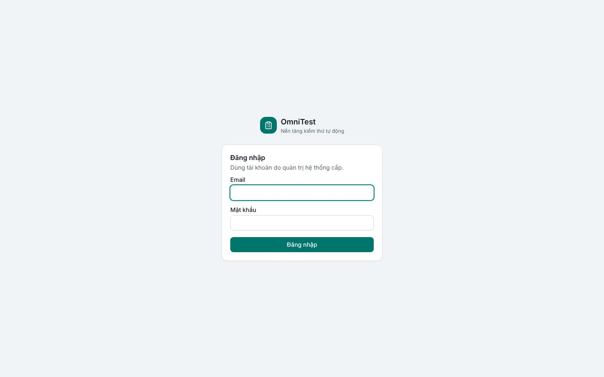

> **Lưu ý**
>
> - Nhập sai mật khẩu nhiều lần liên tiếp, tài khoản bị khóa tạm vài phút để chống dò mật khẩu.
> - Quên mật khẩu: liên hệ quản trị hệ thống. Phiên bản hiện tại chưa có chức năng tự đổi hoặc đặt lại mật khẩu trên giao diện.

### 3. Trang chủ: Cổng kiểm thử

_Điểm xuất phát cho mọi việc: kiểm thử ngay, xem hệ thống của bạn và các lần chạy gần đây._

Màn hình: `/`

1. Khung đầu trang hiển thị số liệu thật: tỷ lệ đạt 14 ngày, số lần đang chạy, số test case, số lần chạy.
2. Bấm **Kiểm thử ngay** để vào luồng kiểm thử 3 bước (nút này cũng có ở thanh trên cùng mọi trang).
3. Khu **Bạn muốn làm gì?** có 4 lối tắt: Kiểm tra nhanh, Chạy bộ test, Soạn test case, Báo cáo.
4. Khu **Hệ thống của bạn** liệt kê môi trường trong các dự án bạn tham gia; bấm **Kiểm thử** cạnh hệ thống nào để kiểm thử hệ thống đó.
5. Khu **Lần chạy gần đây**: bấm tên lần chạy để xem chi tiết.

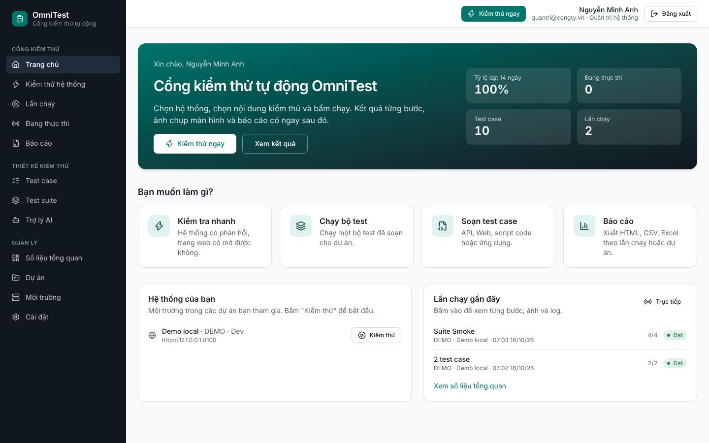

## Kiểm thử hệ thống

### 4. Kiểm thử một hệ thống trong 3 bước

_Cách nhanh nhất để kiểm thử: chọn hệ thống, chọn nội dung, bấm chạy._

Màn hình: `/test`

1. **Bước 1, chọn hệ thống:** chọn **Dự án**, rồi bấm vào thẻ hệ thống (môi trường) cần kiểm thử. Thẻ đang chọn có viền màu.
2. Chưa có hệ thống cần kiểm thử: bấm **Thêm hệ thống khác**, nhập tên, loại (Dev, Test, UAT, Staging) và URL rồi bấm **Thêm** (cần vai trò Manager).
3. **Bước 2, chọn nội dung:** **Kiểm tra nhanh** (hệ thống có phản hồi, trang web mở được, kèm ảnh chụp), **Chạy bộ test** (chọn một suite) hoặc **Chọn test case** (tích từng test).
4. Lần đầu dùng Kiểm tra nhanh trong một dự án: bấm **Tạo bộ kiểm tra nhanh**. OmniTest tạo 2 test case thường (gắn nhãn kiem-tra-nhanh) mà bạn xem và sửa được ở trang Test case.
5. **Bước 3:** kiểm tra lại tóm tắt Dự án, Hệ thống, Nội dung rồi bấm **Bắt đầu kiểm thử**. Trang kết quả mở ngay và tự cập nhật.

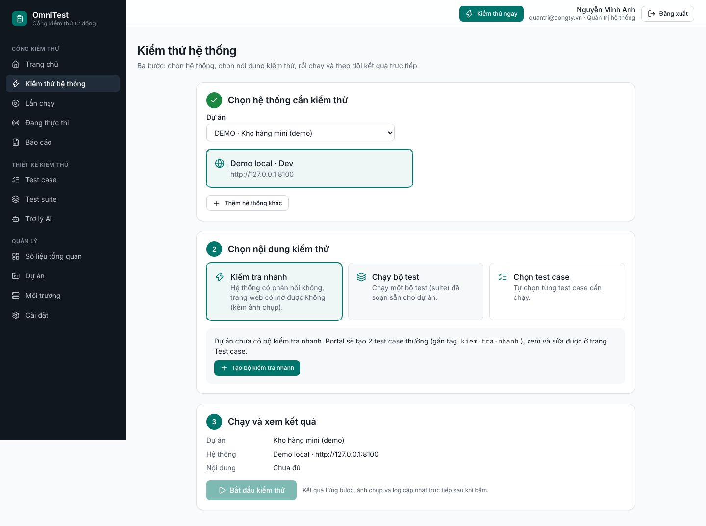

> **Lưu ý**
>
> - Dấu tích xanh ở đầu mỗi bước cho biết bước đó đã đủ thông tin.
> - Vai trò Viewer chỉ xem được kết quả, nút Bắt đầu kiểm thử bị khóa.

### 5. Xác nhận trước khi chạy

_OmniTest hỏi lại khi lần chạy có thể ảnh hưởng tới hệ thống thật._

Màn hình: `/test?mode=suite`

1. Khi bấm **Bắt đầu kiểm thử** (hoặc **Chạy**), nếu có rủi ro, khung vàng **Cần xác nhận trước khi chạy** hiện ra kèm lý do cụ thể.
2. Đọc kỹ lý do: môi trường UAT/Staging, test có thay đổi dữ liệu (thêm, sửa, xóa), hoặc test script code chạy trong sandbox.
3. Đồng ý thì bấm nút đỏ **Tôi xác nhận, chạy**. Không đồng ý thì đổi lựa chọn hoặc rời trang, không có gì được chạy.

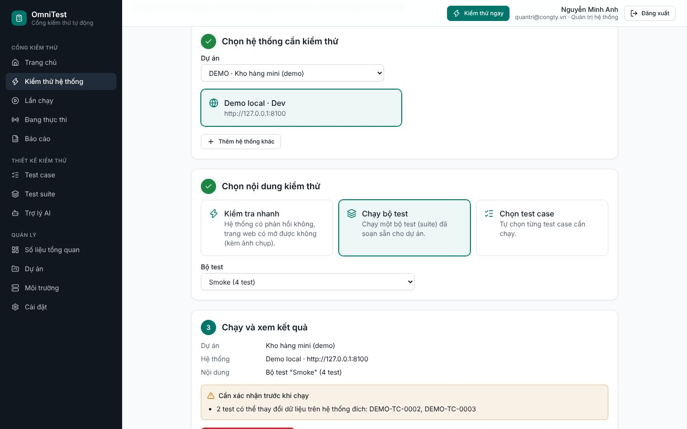

> **Lưu ý**
>
> - Mọi lần chạy cần xác nhận đều được ghi vào nhật ký (audit log) kèm người xác nhận.
> - Test có thay đổi dữ liệu không tự chạy lại khi lỗi, để tránh tạo dữ liệu trùng.

## Kết quả

### 6. Đọc kết quả một lần chạy

_Tiến độ, kết quả từng test case, từng bước, ảnh chụp và log._

Màn hình: `/test-runs`

1. Thanh tiến độ cho biết số test đã xong, số đạt, số không đạt. Trang tự cập nhật khi worker đang chạy, không cần tải lại.
2. Mỗi dòng là một test case với loại (API, Web), thời gian chạy và trạng thái: **Đạt**, **Không đạt**, **Lỗi**, **Bị chặn**, **Bỏ qua**, **Đã hủy**.
3. Bấm vào một test case để mở danh sách bước; bấm vào từng bước để xem chi tiết, log, ảnh chụp màn hình.
4. Tải báo cáo của lần chạy bằng các nút **Báo cáo HTML**, **Excel**, **CSV** ở góc phải.
5. Lần chạy đang chờ hoặc đang chạy có nút **Hủy lần chạy**; trình duyệt và tiến trình kiểm thử được dừng hẳn.

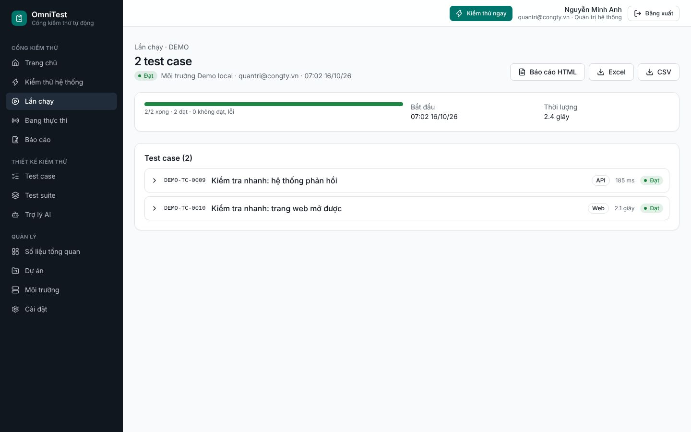

> **Lưu ý**
>
> - Bị chặn nghĩa là chưa đủ điều kiện để chạy (VD hệ thống trỏ tới mạng nội bộ chưa được cho phép, chưa cài driver). OmniTest không bao giờ báo Đạt khi chưa chạy thật.
> - Test Web không đạt có kèm ảnh chụp và file trace Playwright để xem lại từng thao tác.

### 7. Xem từng bước và ảnh chụp màn hình

_Bằng chứng chi tiết cho từng bước kiểm thử._

Màn hình: `/test-runs`

1. Mở một test case trong lần chạy, các bước hiện theo thứ tự với thời gian và trạng thái.
2. Bấm vào bước có ảnh (VD **Chụp màn hình**) để xem ảnh ngay trên trang; bấm tên file ảnh để mở cỡ lớn.
3. Với test API, mở bước để xem request, response và từng điều kiện kiểm tra đạt hay không.

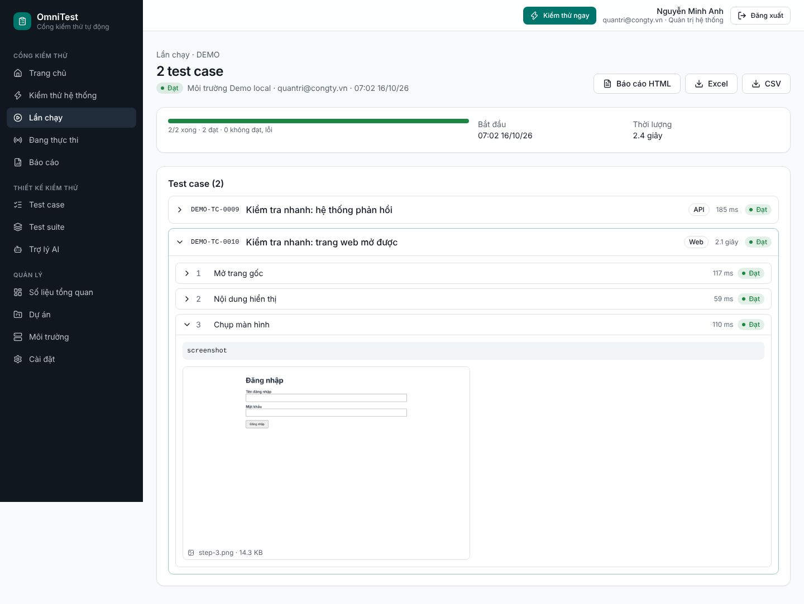

> **Lưu ý**
>
> - Mật khẩu, token và biến bí mật được che (***) trong log, ảnh trace và báo cáo.

### 8. Lịch sử lần chạy và theo dõi trực tiếp

_Tìm lại mọi lần chạy cũ và xem những lần đang chạy._

Màn hình: `/test-runs`

1. Menu **Lần chạy**: chọn dự án, lọc theo **Trạng thái**, bấm tên lần chạy để mở chi tiết.
2. Menu **Đang thực thi**: danh sách các lần đang chờ hoặc đang chạy trong mọi dự án của bạn, tự cập nhật mỗi 2 giây.

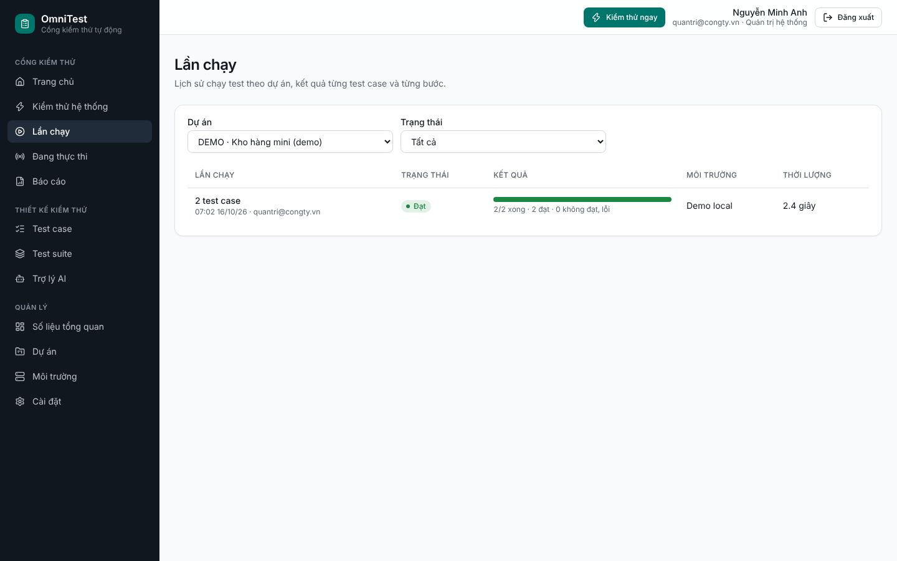

### 9. Báo cáo tổng hợp

_Tỷ lệ đạt theo ngày, môi trường, suite và test case; xuất HTML, CSV, Excel._

Màn hình: `/reports`

1. Chọn dự án, lọc theo **Môi trường**, **Suite**, **Từ ngày**, **Đến ngày**.
2. Xem các bảng **Theo ngày**, **Theo môi trường**, **Theo suite**, **Theo test case** và biểu đồ.
3. Bấm **HTML**, **CSV** hoặc **Excel** để tải báo cáo đúng với bộ lọc đang chọn.

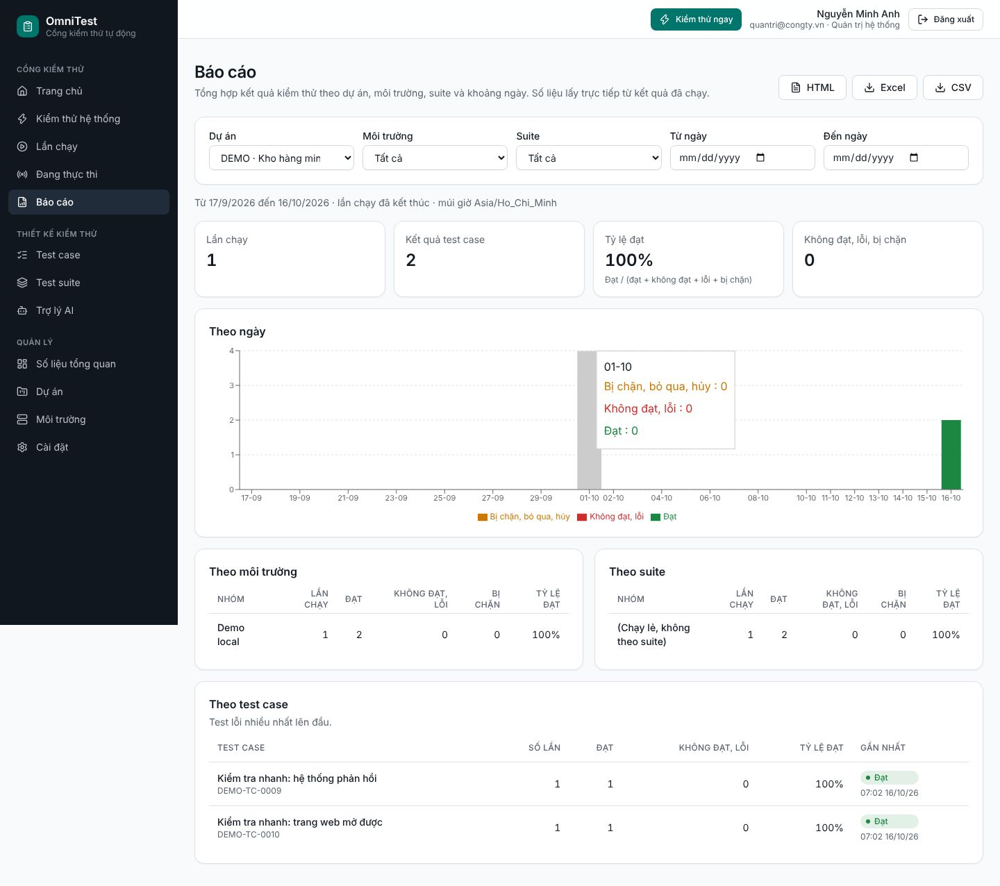

> **Lưu ý**
>
> - Số liệu lấy trực tiếp từ kết quả đã chạy, không ước tính.

## Thiết kế kiểm thử

### 10. Danh sách test case

_Tìm, lọc, chạy, nhập và xuất test case của dự án._

Màn hình: `/test-cases`

1. Chọn dự án; dùng ô **Tìm kiếm**, bộ lọc **Loại**, **Mức ưu tiên**, **Trạng thái** để thu hẹp danh sách.
2. Tích chọn một hoặc nhiều test rồi bấm **Chạy test đã chọn**.
3. **Nhập**: tải file CSV hoặc Excel theo mẫu; lỗi được báo theo từng dòng, chưa ghi gì nếu còn lỗi.
4. **Từ OpenAPI**: tải tài liệu OpenAPI 3 (.json, .yaml) để sinh sẵn test case API cho từng endpoint.
5. Bật **Hiện test case đã xóa** để xem và khôi phục test đã xóa.

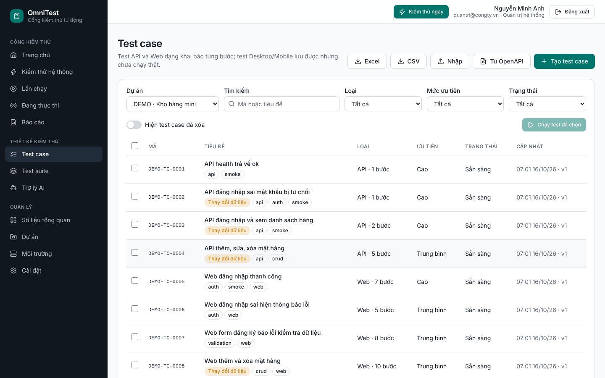

### 11. Soạn test case API

_Gọi API theo từng bước, kiểm tra mã phản hồi, nội dung, header, thời gian._

Màn hình: `/test-cases/new`

1. Bấm **Tạo test case** (hoặc **Soạn test case** ở trang chủ rồi chọn dự án).
2. Phần **Thông tin**: nhập **Tiêu đề**, chọn **Loại test** = API, mức ưu tiên, trạng thái, nhãn.
3. Phần **Các bước**: chọn **Phương thức** (GET, POST...), nhập **URL** tương đối theo Base URL của môi trường (VD /api/health).
4. Thêm **Xác thực**, header, **Body** nếu cần. Dùng biến môi trường dạng {{TEN_BIEN}} thay cho mật khẩu, token.
5. Bấm **Thêm kiểm tra** để khai báo điều kiện: mã phản hồi, giá trị JSON, JSON schema, header, thời gian phản hồi.
6. Muốn dùng kết quả bước này cho bước sau: **Thêm biến** để trích giá trị (VD token) từ response.
7. Phần **Thực thi**: bật **Có thay đổi dữ liệu** nếu test thêm, sửa, xóa dữ liệu; chọn số lần **Thử lại khi lỗi**.
8. Bấm **Tạo test case** để lưu.

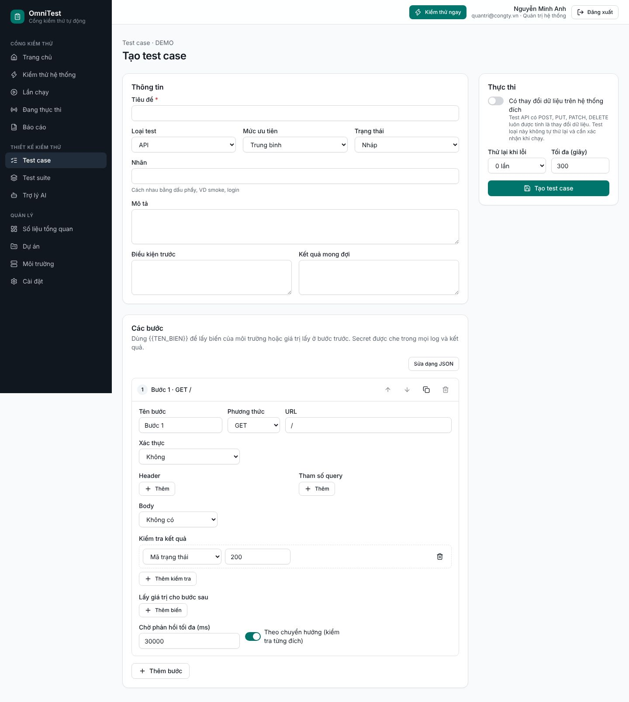

> **Lưu ý**
>
> - Ai thích soạn bằng JSON có thể bấm **Sửa dạng JSON**; nội dung được kiểm tra trước khi lưu.

### 12. Soạn test case Web

_Thao tác trên trình duyệt như người dùng thật: mở trang, nhập, bấm, kiểm tra._

Màn hình: `/test-cases`

1. Chọn **Loại test** = Web; chọn **Trình duyệt** và chế độ **Ghi trace**.
2. Mỗi bước gồm **Tên bước**, **Hành động** (mở trang, bấm, nhập, chọn, chờ, kiểm tra hiển thị, nội dung, URL, tiêu đề, chụp màn hình), **Phần tử** và **Giá trị**.
3. **Phần tử** viết theo cách Playwright tìm: label=Email, role=button[name="Đăng nhập"], text=..., hoặc CSS.
4. Dùng các nút bên phải mỗi bước để đưa lên, đưa xuống, nhân bản, xóa bước; **Thêm bước** ở cuối danh sách.
5. Bấm **Lưu thay đổi**. Mỗi lần lưu tạo một phiên bản mới, xem ở **Lịch sử phiên bản**.
6. Bấm **Chạy** ở đầu trang để chạy ngay test này trên một môi trường.

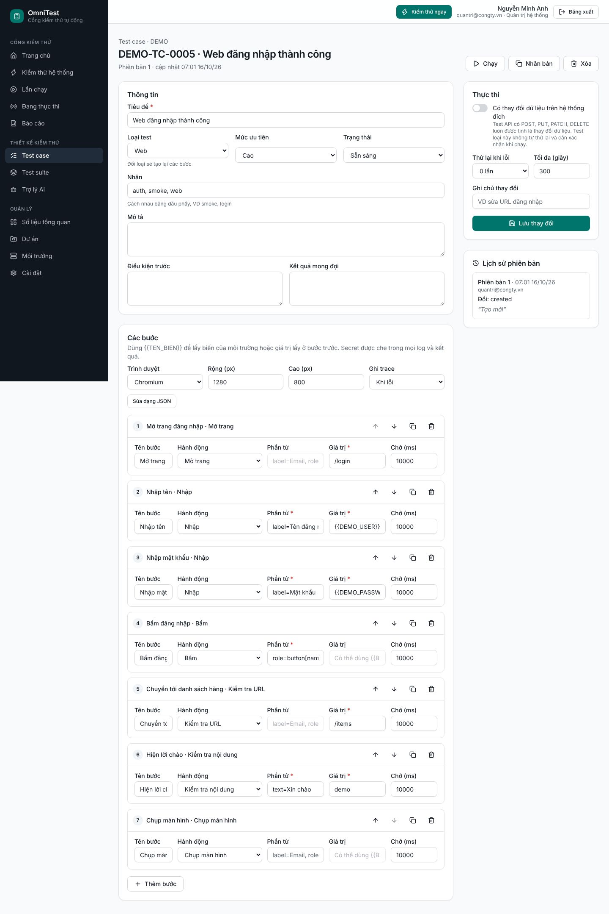

### 13. Bộ test (suite)

_Gom test case theo mục đích (smoke, hồi quy) để chạy cùng nhau._

Màn hình: `/test-suites`

1. Trang **Test suite**: bấm **Tạo suite**, đặt tên và mô tả.
2. Mở suite, bấm **Thêm test case**, tìm và chọn test cần thêm.
3. Sắp xếp thứ tự chạy bằng nút lên, xuống rồi bấm **Lưu thứ tự**; bỏ test khỏi suite bằng nút bỏ ở cuối dòng.
4. Bấm **Chạy suite** để chạy cả bộ, hoặc chọn suite ở bước 2 của Kiểm thử hệ thống.

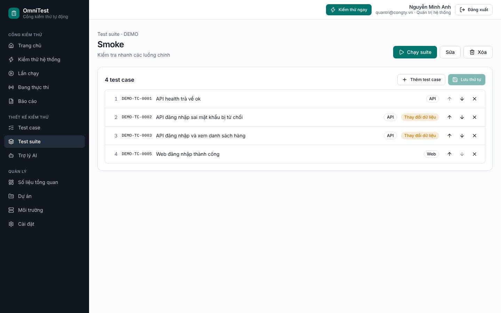

> **Lưu ý**
>
> - Xóa suite chỉ xóa nhóm, không xóa test case và không mất lịch sử chạy.

### 14. Trợ lý AI (tùy chọn)

_Đề xuất test case từ mô tả yêu cầu và phân tích nguyên nhân lỗi._

Màn hình: `/ai`

1. Quản trị hệ thống cấu hình nhà cung cấp AI trên máy chủ; Admin dự án bật **Cho phép dùng Trợ lý AI** trong trang dự án.
2. Nhập mô tả yêu cầu, chọn loại test, bấm đề xuất. Xem giả định và mức độ chắc chắn của từng đề xuất.
3. Tích các đề xuất muốn giữ rồi lưu: test được tạo ở trạng thái Nháp để bạn rà soát trước khi dùng.
4. Ở trang kết quả, test không đạt có nút phân tích lỗi bằng AI.

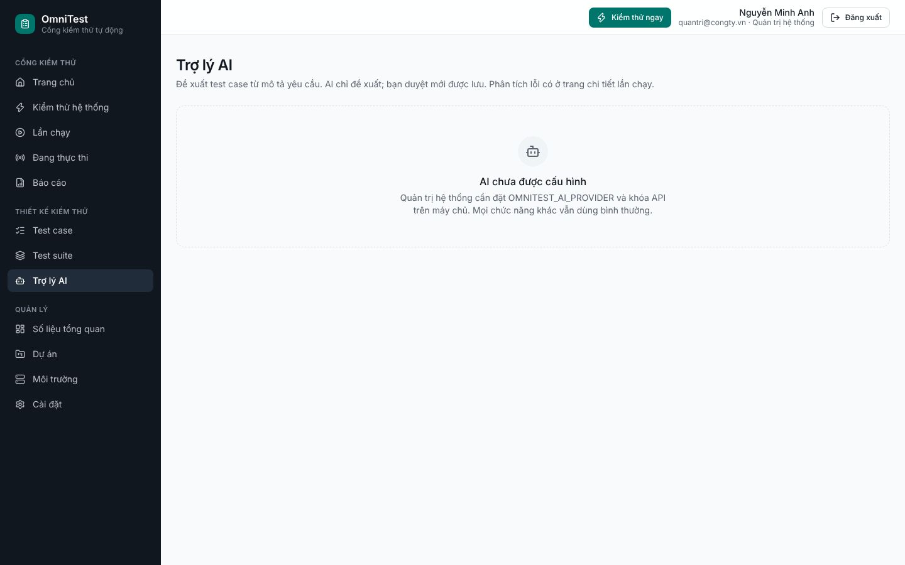

> **Lưu ý**
>
> - AI chỉ đề xuất, không tự lưu, không tự chạy test. Khi chưa cấu hình, trang ghi rõ "AI chưa được cấu hình" và mọi chức năng khác vẫn dùng bình thường.

## Quản lý

### 15. Môi trường và biến bí mật

_Khai báo địa chỉ hệ thống (Dev, Test, UAT, Staging) và biến dùng khi chạy test._

Màn hình: `/environments`

1. Trang **Môi trường**: chọn dự án, bấm **Thêm môi trường**, nhập tên, loại, **Base URL** và các host đích được phép.
2. Mở một môi trường, phần **Biến môi trường**: bấm **Thêm biến** để khai báo tài khoản test, token... Bật **Secret** cho mật khẩu, token, API key (không đổi lại được sau khi tạo).
3. Trong test, dùng {{TEN_BIEN}} để lấy giá trị biến của môi trường đang chạy.
4. Môi trường UAT, Staging mặc định yêu cầu xác nhận trước khi chạy.

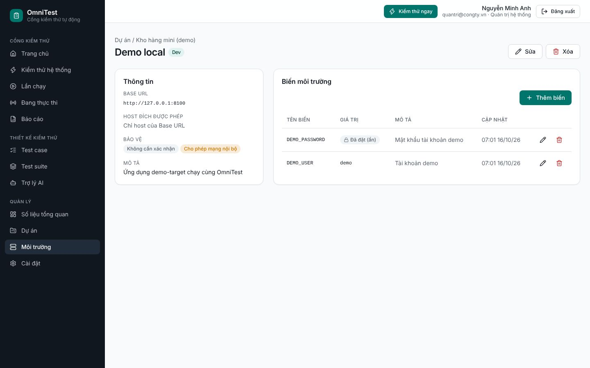

> **Lưu ý**
>
> - Giá trị bí mật được mã hóa, không bao giờ hiển thị lại sau khi lưu, không xuất hiện trong log hay báo cáo.
> - Địa chỉ mạng nội bộ (localhost, 10.x, 192.168.x...) bị chặn để chống tấn công SSRF, trừ khi Admin dự án cho phép trong cấu hình môi trường.

### 16. Dự án, thành viên và phân quyền

_Mỗi dự án có môi trường, test và thành viên riêng._

Màn hình: `/projects`

1. Quản trị hệ thống bấm **Tạo dự án**, nhập mã (VD SHOP) và tên.
2. Mở dự án, tab **Thành viên**: thêm người dùng theo email và chọn vai trò.
3. Vai trò: **Viewer** chỉ xem; **Tester** chạy test; **Manager** soạn test, suite, môi trường; **Admin** quản lý thành viên, bật AI, bật script code, cho phép mạng nội bộ.
4. Tab **Nhật ký** ghi lại thao tác quan trọng trong dự án: sửa biến bí mật, xóa dữ liệu, chạy trên UAT/Staging, bật AI hay script code.
5. **Lưu trữ** dự án khi không dùng nữa: dự án chuyển sang chỉ xem, dữ liệu vẫn giữ.

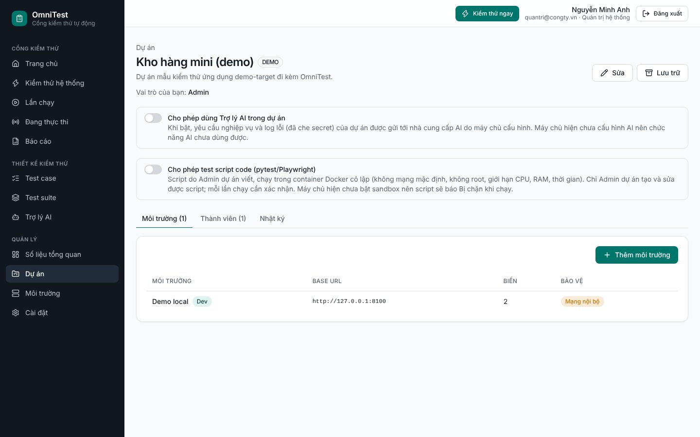

> **Lưu ý**
>
> - Người ngoài dự án không thấy bất kỳ dữ liệu nào của dự án.

### 17. Số liệu tổng quan

_Bức tranh chung: kết quả theo ngày, hoạt động gần đây, test cần chú ý._

Màn hình: `/dashboard`

1. Xem biểu đồ **Kết quả 14 ngày gần nhất** và tỷ lệ đạt.
2. Khu **Cần chú ý** liệt kê test có kết quả gần nhất là lỗi hoặc bị chặn; bấm để mở lần chạy đó.
3. Khu **Hoạt động gần đây** cho biết ai vừa làm gì trong các dự án của bạn.

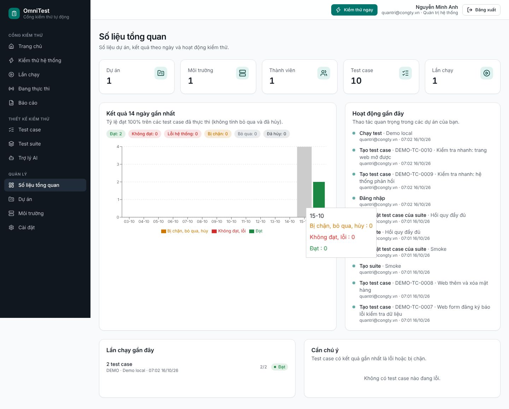

### 18. Cài đặt và tài khoản người dùng

_Thông tin tài khoản; quản trị hệ thống tạo tài khoản người dùng._

Màn hình: `/settings`

1. Phần **Tài khoản của bạn** hiển thị họ tên, email, ngôn ngữ giao diện.
2. Quản trị hệ thống: phần **Người dùng** liệt kê tài khoản và lần đăng nhập gần nhất; bấm **Tạo tài khoản**, nhập email, họ tên, mật khẩu ban đầu rồi gửi mật khẩu cho người dùng qua kênh an toàn.
3. Sau khi tạo tài khoản, thêm người dùng vào dự án ở trang Dự án, tab Thành viên.

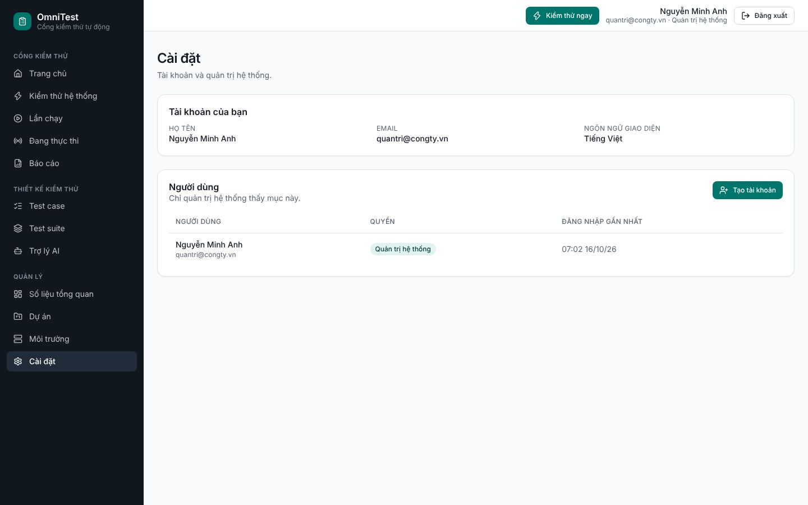

## Hỏi đáp

**Kết quả "Bị chặn" nghĩa là gì?**

Test chưa được chạy vì thiếu điều kiện: hệ thống trỏ tới mạng nội bộ chưa được cho phép, host đích không nằm trong danh sách cho phép, test Desktop/Mobile chưa có Appium và thiết bị, hoặc script code chưa được bật. Mở test case trong lần chạy để đọc lý do cụ thể.

**Tại sao không bấm được Bắt đầu kiểm thử?**

Còn thiếu hệ thống ở bước 1 hoặc nội dung ở bước 2 (bước chưa có dấu tích xanh), hoặc bạn đang có vai trò Viewer.

**Kiểm thử hệ thống của tôi trên Internet bị chặn?**

Kiểm tra Base URL của môi trường có đúng https://... và host có nằm trong danh sách host đích được phép (nếu môi trường có khai báo danh sách này).

**Kiểm tra nhanh báo Không đạt ở bước "hệ thống phản hồi"?**

Trang gốc của hệ thống trả mã khác 2xx (sau khi theo chuyển hướng) hoặc chậm hơn 5 giây. Mở bước để xem mã phản hồi thực tế; có thể sửa test "Kiểm tra nhanh: hệ thống phản hồi" ở trang Test case cho phù hợp với hệ thống.
