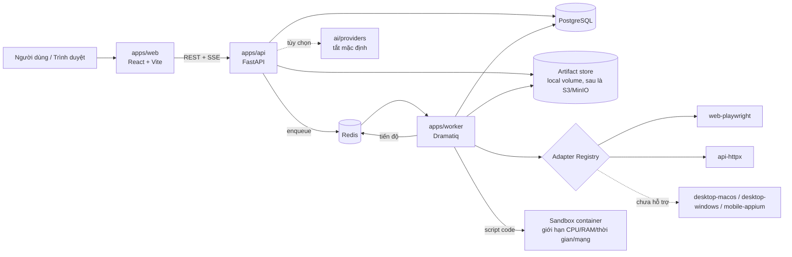

# OmniTest Automation Platform: Khảo sát, kiến trúc và kế hoạch MVP

Phiên bản: 0.1 (16/10/2026). Trạng thái: đề xuất, chờ Hoàng xác nhận. Chưa có dòng code nào được tạo, chưa commit, chưa push.

---

## 0. Tóm tắt khuyến nghị

1. MVP gồm Web UI (Playwright) và API (HTTPX) với quản lý dự án, môi trường, test case, test suite, chạy test qua worker, lịch sử và báo cáo HTML/CSV. AI, Desktop, Mobile làm sau, adapter chưa làm hiển thị rõ "Chưa hỗ trợ".
2. Test case MVP có hai dạng: (a) **khai báo** (bước API/Web dạng JSON có schema, người không giỏi code dùng được qua form), (b) **script code** (pytest + Playwright Python). Dạng (a) là trọng tâm MVP; dạng (b) chỉ chạy trong container sandbox và cần quyền Admin bật.
3. Một ngôn ngữ cho phần thực thi: **Python** (FastAPI, worker, Playwright Python, pytest, HTTPX). Frontend React/TypeScript dùng type sinh tự động từ OpenAPI, tránh lệch contract.
4. Bảo mật đặt từ đầu, không để cuối: phân quyền theo dự án, mã hóa secret, chặn SSRF, sandbox cho script, audit log.
5. Cần Hoàng quyết định 6 điểm ở mục 9 trước khi bắt đầu Giai đoạn 2. Quan trọng nhất là **nơi đặt source và quyền push**.

---

## 1. Kết quả khảo sát môi trường

### 1.1 Source hiện có
- Chưa có source OmniTest ở bất kỳ đâu (thư mục dự án, máy Mac, GitHub). Dự án bắt đầu từ đầu.
- Repo TCS-46Gate trên máy Mac là dự án khác: **không dùng, không đụng tới**.

### 1.2 Môi trường cloud (đã kiểm tra thực tế, 16/10/2026)

| Thành phần | Kết quả | Ghi chú |
|---|---|---|
| Python | 3.13.16 | Đủ cho FastAPI, SQLAlchemy 2, Playwright |
| uv | 0.11.32 | Quản lý môi trường Python |
| Node / npm / pnpm | 22.22.0 / 10.9.4 / 10.28.0 | Đủ cho Vite, React |
| PostgreSQL | 16.15 (binary) | Chạy được trực tiếp, không cần Docker |
| Redis | 7.0.15 (binary) | Chạy được trực tiếp |
| Playwright Chromium | Có sẵn (build 1194) | Chạy test Web headless được |
| Docker | Có client, **không có daemon** | Không chạy được Docker Compose, không có sandbox container |
| Git | 2.43.0 | Thư mục làm việc chưa là repo |
| Tài nguyên | 4 CPU, 15 GB RAM, ~31 GB đĩa trống, x86_64 | |

Hạn chế: container cloud là tạm thời, mất khi phiên kết thúc. Muốn giữ code ở cloud thì bắt buộc phải push lên GitHub.

### 1.3 Máy Mac của Hoàng (chưa kiểm tra được, cần phiên trên máy)
Theo ghi nhận trước đây của dự án: máy Mac **chưa có Node** và **chưa có gh**. Cần kiểm tra khi mở phiên trên máy:

```
sw_vers; uname -m                      # macOS version, Apple Silicon hay Intel
python3 --version; which uv            # cần Python >= 3.12
node --version; pnpm --version         # cần Node >= 20 (hiện chưa có)
docker version; docker compose version # cần Docker Desktop hoặc OrbStack/Colima
psql --version; redis-server --version # không bắt buộc nếu dùng Docker
xcode-select -p                        # cần cho adapter macOS sau này
df -h ~; sysctl hw.memsize             # đĩa, RAM (khuyến nghị >= 16 GB)
```

---

## 2. Kiến trúc đề xuất

### 2.1 Sơ đồ tổng thể



### 2.2 Thành phần và trách nhiệm

| Thành phần | Công nghệ | Trách nhiệm |
|---|---|---|
| apps/web | React 18, TypeScript, Vite, Tailwind, shadcn/ui, TanStack Query, React Router, react-hook-form + zod, Recharts, i18next | Toàn bộ giao diện, mặc định tiếng Việt |
| apps/api | FastAPI, Pydantic v2, SQLAlchemy 2 (async), Alembic, asyncpg | REST API, xác thực, phân quyền, quản lý dữ liệu, enqueue run, phát SSE tiến độ |
| apps/worker | Dramatiq + Redis | Lấy job, gọi adapter, áp timeout, retry, hủy, lưu kết quả và bằng chứng |
| packages/contracts | Pydantic (nguồn gốc) → OpenAPI → TypeScript (openapi-typescript) | Một nguồn schema duy nhất cho API, worker, web |
| packages/test-sdk | Python | Helper cho script code: đọc biến môi trường, lấy secret an toàn, ghi bước, chụp màn hình |
| adapters/* | Python, theo contract chung | Thực thi từng loại test |
| ai/* | Python | Lớp provider độc lập, prompt, sinh test, phân tích lỗi (Giai đoạn 5) |

### 2.3 Contract adapter thống nhất

```python
class Adapter(Protocol):
    key: str  # "web-playwright", "api-httpx", ...
    display_name: str
    status: Literal["supported", "experimental", "not_supported"]

    def capabilities(self) -> Capabilities: ...
    def check_environment(self) -> EnvironmentCheck: ...  # driver có sẵn chưa
    def validate(self, definition: TestDefinition) -> list[ValidationIssue]: ...
    async def execute(self, ctx: ExecutionContext, definition: TestDefinition) -> AdapterResult: ...
```

- `ExecutionContext`: biến môi trường đã giải mã (chỉ trong bộ nhớ), deadline, cờ hủy, logger đã che secret, nơi ghi artifact.
- `AdapterResult`: chuẩn hóa về `status` (passed/failed/skipped/blocked/error), danh sách `StepResult` (tên, thời gian, trạng thái, log, ảnh, lỗi), artifact.
- Adapter `not_supported` trả `blocked` với lý do "Adapter chưa được hỗ trợ", **không bao giờ trả passed**. Có test tự động kiểm tra điều này.

### 2.4 Mô hình dữ liệu chính (MVP)

| Bảng | Nội dung chính |
|---|---|
| users, roles, project_members | Tài khoản, vai trò theo từng dự án |
| projects | Tên, mã, mô tả, trạng thái |
| environments | Dev/Test/UAT/Staging, base URL, danh sách host được phép |
| environment_variables | Khóa, giá trị, cờ `is_secret`; secret mã hóa AES-GCM |
| test_cases | Mã ổn định (VD `PRJ-TC-0001`), tên, mô tả, loại, priority, preconditions, steps, test data, expected, trạng thái, `side_effect`, `retry_policy`, version |
| test_case_versions | Lịch sử thay đổi (ai, khi nào, diff) |
| test_suites, suite_items | Nhóm và thứ tự test |
| test_runs | Phạm vi, môi trường, người chạy, trạng thái, thời gian, thống kê |
| test_run_items | Kết quả từng test case, số lần thử |
| step_results | Kết quả từng bước |
| artifacts | Ảnh, trace, log, report (đường dẫn, kích thước, hash) |
| audit_logs | Thao tác quan trọng (ai, gì, khi nào, IP) |

Trạng thái run: `queued → running → passed | failed | skipped | blocked | cancelled | error`. Máy trạng thái được kiểm tra bằng unit test.

### 2.5 Luồng chạy test

1. Người dùng chọn test case/suite + môi trường → API kiểm tra quyền, tạo `test_run` (queued), ghi audit, enqueue.
2. Worker nhận job → kiểm tra cờ hủy → giải mã biến môi trường trong bộ nhớ → gọi adapter theo từng test.
3. Mỗi bước: ghi log (đã che secret), ảnh/trace khi lỗi, đẩy tiến độ lên Redis pub/sub → API phát SSE cho màn hình Live Execution.
4. Retry chỉ áp dụng khi test có `side_effect = false` và `retry_policy` cho phép. Test có side effect không tự retry.
5. Hủy: API đặt cờ hủy → worker dừng an toàn giữa các bước, đóng trình duyệt, kill sandbox → trạng thái `cancelled`.
6. Kết thúc: tổng hợp thống kê, sinh HTML report, lưu artifact.

---

## 3. Phạm vi MVP (Giai đoạn 2 đến 4)

### 3.1 Trong phạm vi
- Đăng nhập, phân quyền 4 vai trò theo dự án: Admin, Manager, Tester, Viewer.
- Dashboard: tổng dự án/test case/run, Passed/Failed/Skipped/Blocked, tỷ lệ thành công, biểu đồ lịch sử, run gần đây, lỗi cần chú ý (số liệu thật từ DB, không dữ liệu giả).
- Dự án, môi trường (Dev/Test/UAT/Staging), biến môi trường và secret mã hóa.
- Test case: tạo, sửa, xóa mềm có xác nhận, sao chép, phân loại, lịch sử thay đổi; import/export CSV và Excel.
- Test suite.
- API test khai báo: method, URL, headers, query, body, auth (Basic, Bearer, API key); assertion status, body (JSONPath), JSON schema, header, thời gian phản hồi; truyền biến giữa các bước; import OpenAPI 3 (tạo khung test case).
- Web test khai báo: URL, browser (Chromium; Firefox/WebKit tùy môi trường), viewport, các hành động goto/fill/click/select/expect, chờ theo điều kiện (không sleep cố định), screenshot, trace.
- Script code (pytest + Playwright Python) chạy trong sandbox, tắt mặc định.
- Worker: queued/running/hủy/timeout/retry an toàn, log từng bước.
- Báo cáo: theo dự án, suite, môi trường, run; chi tiết từng bước, stack trace, ảnh, log; xuất HTML, CSV, Excel.
- Ứng dụng demo nội bộ (apps/demo-target) với đăng nhập, form validation, CRUD, kèm bộ test mẫu.
- Docker Compose cho môi trường phát triển.

### 3.2 Ngoài phạm vi MVP
- AI Test Assistant (Giai đoạn 5).
- Desktop macOS/Windows, Mobile Android/iOS (Giai đoạn 6).
- SSO/LDAP, đa tenant, lập lịch chạy định kỳ, tích hợp Jira, CI/CD trigger từ bên ngoài (đưa vào backlog).
- Allure (HTML report tự xây trước; Allure là tùy chọn sau nếu cần).

---

## 4. Cấu trúc thư mục

```
omnitest/
├── apps/
│   ├── web/                  # React + Vite
│   ├── api/                  # FastAPI, Alembic migrations trong apps/api/migrations
│   ├── worker/               # Dramatiq worker
│   └── demo-target/          # [BỔ SUNG] ứng dụng demo cho bộ test mẫu
├── packages/
│   ├── contracts/            # Pydantic schema + OpenAPI + TS types sinh tự động
│   └── test-sdk/             # Helper Python cho script code
├── adapters/
│   ├── core/                 # [BỔ SUNG] Protocol, registry, kiểu kết quả chung
│   ├── web-playwright/
│   ├── api-httpx/            # [ĐỔI TÊN] từ api-pytest, xem lý do
│   ├── desktop-macos/        # khung + status not_supported
│   ├── desktop-windows/      # khung + status not_supported
│   └── mobile-appium/        # khung + status not_supported
├── ai/
│   ├── providers/  prompts/  test_generation/  failure_analysis/
├── tests/
│   ├── unit/  integration/  e2e/  security/
├── infra/
│   ├── docker/               # Dockerfile api/worker/web/sandbox, compose
│   └── scripts/              # dev.sh, seed admin, kiểm tra môi trường
├── docs/                     # kiến trúc, hướng dẫn, ADR, báo cáo từng giai đoạn
├── .env.example              # chỉ tên biến, không có giá trị thật
└── README.md
```

Điều chỉnh so với định hướng ban đầu và lý do:
- **apps/demo-target**: yêu cầu có bộ test mẫu đăng nhập/form/CRUD; cần một ứng dụng đích do mình kiểm soát, không test trên hệ thống thật của khách hàng.
- **adapters/core**: contract và registry dùng chung, tránh mỗi adapter tự định nghĩa.
- **api-httpx thay api-pytest**: test API khai báo được worker thực thi trực tiếp bằng HTTPX, nhanh, kiểm soát SSRF tốt hơn. pytest vẫn dùng cho script code và cho test nội bộ của hệ thống.
- **Migrations nằm trong apps/api**: Alembic gắn với model của API.

---

## 5. Rủi ro kỹ thuật và bảo mật

### 5.1 Bảo mật

| Rủi ro | Mức | Biện pháp |
|---|---|---|
| Thực thi mã tùy ý qua script code | Rất cao | Chạy trong container sandbox riêng: user không root, filesystem read-only, giới hạn CPU/RAM/PID/thời gian, không mount Docker socket, mạng chỉ ra các host được phép. Tắt mặc định, chỉ Admin bật theo dự án. Worker chính không bao giờ `exec`/`eval` nội dung người dùng. |
| SSRF qua API/Web test | Cao | Phân giải DNS rồi kiểm tra IP thật (chống DNS rebinding), chặn loopback, link-local, 169.254.169.254 và metadata cloud (luôn chặn), dải private chỉ mở khi Admin thêm vào allowlist của môi trường; kiểm tra lại sau mỗi redirect. |
| Lộ secret | Cao | AES-GCM với master key từ biến môi trường; API không bao giờ trả giá trị secret; bộ lọc log che giá trị secret và header Authorization/Cookie; không lưu secret vào trace (trace có thể chứa dữ liệu form, cần cảnh báo và cho tắt). |
| Truy cập chéo dự án (IDOR) | Cao | Mọi truy vấn lọc theo project + kiểm tra vai trò ở một dependency chung; bộ test bảo mật tự động cho từng endpoint. |
| Upload độc hại (CSV/Excel/OpenAPI) | Trung bình | Giới hạn kích thước, kiểm tra MIME + phần mở rộng, openpyxl read-only, chặn CSV formula injection khi export. |
| Chạy test trên hệ thống khách hàng ngoài ý muốn | Trung bình | Môi trường gắn nhãn; chạy trên UAT/Staging cần xác nhận; test có side effect cần xác nhận trước khi chạy. |
| Brute force đăng nhập | Trung bình | Argon2 hash, rate limit, khóa tạm thời. |
| AI (sau này) | Trung bình | AI chỉ đề xuất; người dùng duyệt mới lưu/chạy; không cấp quyền gọi lệnh hệ thống. |

### 5.2 Kỹ thuật

| Rủi ro | Biện pháp |
|---|---|
| Test Web flaky | Chờ theo điều kiện của Playwright, trace khi lỗi, retry chỉ cho test không side effect |
| Hủy giữa chừng để lại tài nguyên treo | Cờ hủy kiểm tra giữa các bước, `finally` đóng browser, kill container theo nhãn |
| Worker chết giữa chừng | Heartbeat; run quá hạn chuyển `error` kèm lý do |
| Artifact phình to | Chính sách lưu giữ, giới hạn kích thước, chỉ trace khi lỗi (cấu hình được) |
| Lệch contract web và api | Sinh TS type từ OpenAPI trong bước build, CI báo lỗi khi lệch |
| Môi trường cloud không có Docker | Phát triển API/worker/web chạy trực tiếp; sandbox và Compose kiểm tra trên máy có Docker |
| Mac chưa có Node, Docker | Cần cài trước khi chạy đầy đủ trên máy |
| Desktop/Mobile cần thiết bị thật | Không giả lập; adapter để `not_supported` cho tới khi có driver và thiết bị |

---

## 6. Kế hoạch triển khai theo giai đoạn

Ước lượng là ước lượng sơ bộ theo ngày làm việc, sẽ chỉnh sau Giai đoạn 2.

| GĐ | Nội dung | Kết quả bàn giao | Ước lượng |
|---|---|---|---|
| 1 | Khảo sát, kiến trúc, phạm vi MVP | Tài liệu này | Xong (chờ duyệt) |
| 2 | Khung monorepo, Compose, DB + migration, auth, phân quyền, dự án, môi trường, secret, layout UI, Dashboard rỗng có empty state | Đăng nhập, quản lý dự án và môi trường chạy được | 5 đến 7 |
| 3 | Test case, suite, import/export, lịch sử; worker; adapter API và Web; hủy, timeout, retry; Live Execution; demo-target + bộ test mẫu | Chạy được test API và Web thật trên demo-target | 8 đến 12 |
| 4 | Báo cáo HTML/CSV/Excel, artifact, SSRF guard, sandbox script, audit log, test bảo mật | MVP hoàn chỉnh, có báo cáo và bảo mật | 5 đến 7 |
| 5 | AI provider, sinh test case, sinh script nháp, phân tích lỗi, luồng duyệt | AI Assistant tùy chọn | 5 đến 8 |
| 6 | Desktop macOS (Appium Mac2 / XCUITest), Windows (WinAppDriver hoặc Appium Windows), Mobile Appium | Theo môi trường thật có sẵn | Tùy thiết bị |
| 7 | Tối ưu, tài liệu, CI/CD (GitHub Actions), nghiệm thu | Bản phát hành | 4 đến 6 |

Mỗi giai đoạn bàn giao báo cáo trong `docs/phases/phase-N.md` gồm: mục tiêu, tiêu chí nghiệm thu và kết quả từng tiêu chí, file/module thay đổi, test đã viết, **output chạy test thực tế**, lỗi còn tồn tại, hướng dẫn chạy và sử dụng.

---

## 7. Tiêu chí nghiệm thu

### Giai đoạn 2
- `docker compose up` (hoặc script dev) khởi động web, api, worker, postgres, redis; `alembic upgrade head` chạy sạch trên DB rỗng.
- Đăng nhập/đăng xuất; sai mật khẩu nhiều lần bị khóa tạm thời.
- Tạo/sửa/xem dự án và môi trường; secret không bao giờ xuất hiện trong response API, log, DB dạng văn bản thuần (có test kiểm tra).
- Viewer không sửa được; người ngoài dự án nhận 404/403 (có test tự động cho mọi endpoint).
- Giao diện có loading, empty, error state, thông báo thao tác; hiển thị tốt ở 375px và 1440px (kiểm tra bằng trình duyệt thật, có ảnh chụp).
- Unit + integration test pass, lint (ruff, eslint) và type check (mypy/pyright, tsc) sạch.

### Giai đoạn 3
- Tạo test case API khai báo, chạy trên demo-target, đủ assertion status/body/schema/header/thời gian; biến truyền được giữa các bước.
- Bộ test Web mẫu (đăng nhập, form validation, CRUD) chạy pass trên demo-target; cố tình làm hỏng thì báo failed kèm ảnh và trace.
- Hủy run đang chạy về `cancelled` trong thời gian cấu hình, không còn tiến trình trình duyệt treo.
- Timeout chuyển đúng trạng thái; test có side effect không bị retry (có test).
- Adapter Desktop/Mobile hiển thị "Chưa hỗ trợ", chạy thì trả `blocked`, không bao giờ `passed` (có test).
- Import CSV/Excel đúng mẫu; file sai định dạng báo lỗi theo dòng; export mở được trong Excel.
- Live Execution cập nhật trạng thái không cần tải lại trang.

### Giai đoạn 4
- Báo cáo HTML/CSV/Excel theo run, suite, môi trường, dự án; khớp số liệu với DB.
- Bộ test bảo mật pass: SSRF (127.0.0.1, 169.254.169.254, IPv6 loopback, DNS rebinding, redirect sang IP nội bộ), IDOR, upload quá cỡ/sai loại, che secret trong log và report.
- Script code chạy trong sandbox; script thử đọc file hệ thống, gọi mạng ngoài allowlist, vượt RAM/thời gian đều bị chặn (có test).
- Audit log ghi đủ: đăng nhập, sửa secret, xóa dữ liệu, chạy test trên UAT/Staging, bật script code.

### Giai đoạn 5 (AI)
- Tắt AI thì toàn bộ chức năng khác hoạt động bình thường.
- Kết quả AI hiển thị giả định, mức độ không chắc chắn, nguồn; chỉ lưu sau khi người dùng duyệt; AI không có đường gọi ghi DB trực tiếp.
- API key chỉ lấy từ cấu hình, không xuất hiện trong log.

---

## 8. Quy tắc làm việc áp dụng cho OmniTest

- Không commit, không push khi Hoàng chưa cho phép (khác quy tắc của TCS-46Gate).
- Không ghi đè, xóa, reset source/dữ liệu có sẵn khi chưa được phép.
- Không đưa secret vào code, Git, log; chỉ có `.env.example`.
- Không báo test pass khi chưa chạy; báo cáo luôn kèm output thật.
- Không giả lập kết quả thành công cho adapter chưa có driver.

---

## 9. Quyết định cần Hoàng xác nhận

| # | Câu hỏi | Mặc định tôi đề xuất | Lý do |
|---|---|---|---|
| 1 | Đặt source ở đâu | **Repo GitHub private riêng `omnitest`**, phát triển trong môi trường cloud, Hoàng cho phép push lên nhánh `dev` sau mỗi giai đoạn (không đụng `main` khi chưa duyệt). Máy Mac dùng để chạy Docker Compose, sandbox và adapter macOS sau này. | Cloud có sẵn Python, Node, Postgres, Redis, Chromium nên làm ngay được; nhưng cloud là tạm thời nên không push thì mất code. Phương án chỉ dùng Mac cần cài Node và Docker trước. |
| 2 | Bên chạy worker | Dramatiq + Redis | Đơn giản, ổn định, đủ cho hủy/timeout; Celery nặng hơn mức cần |
| 3 | Ngôn ngữ script code | Python (pytest + Playwright Python) | Thống nhất với worker, một sandbox image |
| 4 | Test trên hệ thống nội bộ (IP private) | Chặn mặc định, Admin mở theo allowlist từng môi trường; metadata cloud luôn chặn | QA thường test staging nội bộ nên không thể chặn cứng |
| 5 | Xác thực | Tài khoản nội bộ (email + mật khẩu, Argon2), cookie phiên HttpOnly; SSO để sau | Đủ cho MVP, ít phụ thuộc |
| 6 | Báo cáo | HTML tự xây + Playwright trace; Allure để tùy chọn | Ít phụ thuộc Java/Allure CLI |

Sau khi Hoàng xác nhận, tôi bắt đầu Giai đoạn 2 và báo cáo theo mẫu ở mục 6.
